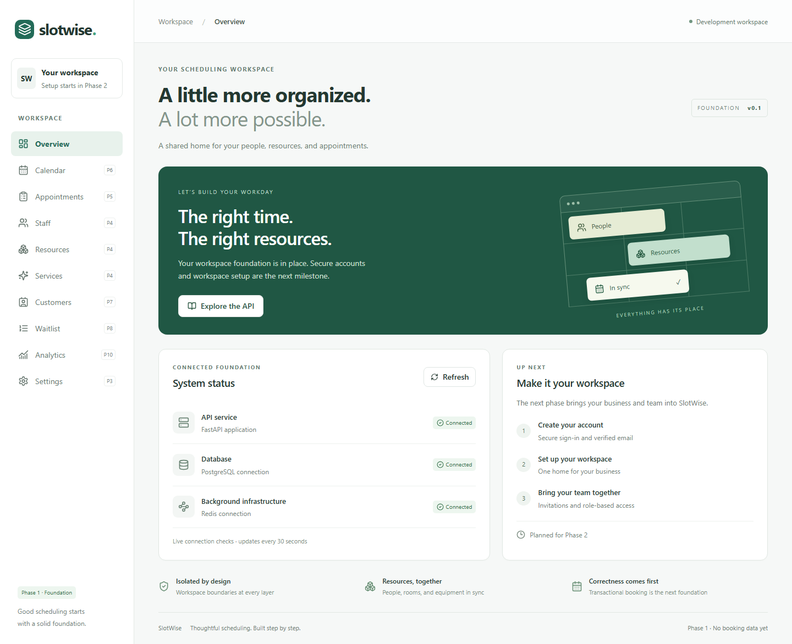

# SlotWise

Intelligent appointment and resource scheduling, built as a Python/TypeScript
portfolio application. **Current scope: foundation plus secure accounts and
workspaces, business configuration, staff, resources and services (Phases 1–4).** Appointment scheduling is a later phase;
this is not ready for business use or public deployment.



The screenshot uses the verified Docker stack with PostgreSQL and Redis connected.
[Mobile screenshot](docs/screenshots/foundation-mobile.png).

Phase 2 screenshots from the real account lifecycle tests:
[desktop workspace](docs/screenshots/workspace-desktop.png),
[mobile workspace](docs/screenshots/workspace-mobile.png),
[desktop login](docs/screenshots/login-desktop.png),
[mobile login](docs/screenshots/login-mobile.png).

## Business configuration

After signing in and verifying your email, select a workspace and open **Business
settings**. Owners can update the business profile, contact fields, booking defaults,
locations, weekly opening hours and dated holidays/special hours. Managers can review
settings. Employees/customers cannot access internal configuration.

Each location has its own IANA zone. Weekly dates without intervals are closed;
special hours replace the whole date and holidays close it. Split overnight hours
across two weekdays and use 24:00 only for an ending boundary. Deactivate locations
instead of deleting their configuration. Save first, then use the seven-day preview
to inspect actual local offsets across DST transitions. The preview shows operating
hours, not bookable appointments. Booking-policy enforcement arrives with booking.

Stale saves return a conflict instead of overwriting another edit. Use **Reload saved
settings** to discard the local draft and obtain the latest version. Business default
zone changes leave existing locations unchanged. Holidays are explicit dated entries;
there is no automatic national calendar import.

Verified screenshots: [desktop settings](docs/screenshots/settings-desktop.png),
[mobile settings](docs/screenshots/settings-mobile.png),
[desktop saved-hours preview](docs/screenshots/hours-preview-desktop.png),
[mobile saved-hours preview](docs/screenshots/hours-preview-mobile.png).

## Local development

### Configure staff, resources and services

Open **Scheduling setup** in a verified owner or manager workspace:

1. Create locations and opening hours in **Business settings**.
2. Add **Skills**, then **Staff** profiles with qualifications, expiry dates,
   capacity, weekly hours, breaks, dated exceptions and approved leave.
3. Add **Resources** with a location, type, capacity, attributes, availability and
   maintenance. Group interchangeable assets into **Resource pools**.
4. Add **Services** with duration bounds, price, buffers, locations, required skills,
   eligible staff and resource requirements. Empty staff/resource selections allow
   all otherwise eligible candidates; skill requirements always apply.
5. Save, then use the seven-day staff/resource preview or **Check staff and resources**
   for a service. These inspect configuration; they do not reserve appointments.

Resource quantity means distinct assets; units per asset means simultaneous capacity.
Deactivate records to preserve configuration and stable capacity-unit IDs. A stale
save keeps your draft and asks you to reload. Staff job titles do not grant account
permissions. Time off and maintenance use explicit UTC inputs; previews display the
location's IANA zone. Staff profiles currently belong to one location.

Screenshots: [staff desktop](docs/screenshots/staff-desktop.png),
[staff mobile](docs/screenshots/staff-mobile.png),
[service desktop](docs/screenshots/service-desktop.png),
[service mobile](docs/screenshots/service-mobile.png).

### Start the stack

Prerequisites: Docker Engine/Desktop with Compose v2, Python 3.13, uv 0.13.6,
Node 22.12+ and pnpm 10.11.0. With Node installed, enable pnpm using
`corepack enable` and `corepack prepare pnpm@10.11.0 --activate`.

From the repository root (PowerShell):

```powershell
Copy-Item .env.example .env
docker compose up --build --wait --wait-timeout 240
```

Open [workspace](http://localhost:5173), [API docs](http://localhost:8000/api/docs),
and [Mailpit](http://localhost:8025). Compose runs migrations before starting the API.
Use `docker compose logs -f` for diagnostics and `docker compose down` to stop while
preserving database volumes. `docker compose down --volumes` deletes local data.

### Try the account flow

1. Open [Create account](http://localhost:5173/account/register) and register with a
   synthetic address (for example, `your-demo@example.com`) and a 12+ character password.
2. Open Mailpit and follow the verification link, then sign in at
   [Sign in](http://localhost:5173/account/login).
3. Create a workspace at [Your workspaces](http://localhost:5173/app). Invite a second
   synthetic address; register/verify that account in another browser profile and
   reopen its invitation email to accept.
4. Owners can change roles, revoke invites and remove members. The last owner cannot
   be removed or demoted. Workspace switching preserves separate membership roles.
5. Use “Forgot password?” to receive a one-hour reset link; resetting signs out all
   existing sessions for that account. Invite links expire after seven days.

All Compose email goes to local Mailpit. There are no seeded/shared login credentials.
Open the full email link including its fragment; account pages remove bearer tokens
from history on arrival. If an invitation requires login, sign in and reopen the
original invitation email. No token is stored in localStorage or sessionStorage.

The account mail worker is enabled in Compose. With a local Python backend, copy the
updated backend/.env.example, including SLOTWISE_MAIL_WORKER_ENABLED=true. Production
requires an explicit mail-encryption secret, HTTPS trusted/public origins, and your
SMTP configuration; development defaults are not deployment credentials.

### This Windows machine: Docker in Ubuntu WSL2

Docker Engine and Compose are installed inside the existing Ubuntu distribution.
Docker Desktop is not required, and `docker` is not on the Windows PATH. From this
repository in PowerShell, use:

```powershell
wsl -d Ubuntu -u root -- bash -lc 'cd /mnt/c/Vlad/python/SceduleManagementApp && docker compose up --build'
wsl -d Ubuntu -u root -- bash -lc 'cd /mnt/c/Vlad/python/SceduleManagementApp && docker compose ps'
```

Keep that attached terminal open while using the app. This WSL host shuts down idle
distributions even when Docker is managed by systemd; an attached Compose process
keeps the session active. Use a second terminal for checks. The web URLs above are
reachable from Windows. Run database integration tests inside
Compose; direct Windows Python connections to the WSL-published database/Redis ports
were unreliable on this host. No Docker group membership changes were made. To stop
the project while retaining data, use the same WSL prefix with `docker compose down`.

Docker was installed through the [official Ubuntu repository](https://docs.docker.com/engine/install/ubuntu/).

For hot reload, run only dependencies with `docker compose up -d postgres redis mailpit`,
then start the backend and frontend in separate terminals:

```powershell
cd backend
Copy-Item .env.example .env
uv sync --frozen --python 3.13
uv run alembic upgrade head
uv run uvicorn slotwise.main:app --reload --no-access-log
```

```powershell
cd frontend
pnpm install --frozen-lockfile
pnpm dev
```

Vite proxies `/api` to port 8000. `API_PROXY_TARGET` overrides that development proxy
target. Without PostgreSQL/Redis, the frontend and API can still run: liveness is 200
and readiness is 503, which the UI displays honestly. No seeded accounts exist yet.
Root `.env` configures Compose; `backend/.env` configures local Python. Keep both
untracked. Local password defaults are for loopback-only development; URL-encode any
reserved characters if changing credentials interpolated into a database URL.

## Checks

```powershell
cd backend
uv run ruff check .
uv run ruff format --check .
uv run mypy src
uv run pytest
uv run alembic upgrade head --sql
```

```powershell
cd frontend
pnpm lint
pnpm format:check
pnpm build
pnpm test
pnpm exec playwright install chromium
pnpm test:e2e
```

The Playwright shell tests intercept health responses to test UI behavior. The
additional full-stack tests use real responses, require the built Compose stack,
and verify the Nginx frontend, health, refresh, and Swagger documentation on desktop
and mobile. To run the complete acceptance gate after starting Compose:

```powershell
# In the Docker environment (Ubuntu WSL on this machine):
docker compose --profile test run --build --rm test
# At the repository root, with Python available:
python infra/check_stack.py
# In frontend/ on Windows:
$env:SLOTWISE_FULL_STACK='1'
pnpm test:e2e
```

The test profile builds a separate image containing pytest and runs all backend tests,
including PostgreSQL/Redis readiness, applied migration, identity, tenant isolation,
CSRF, rotation/reuse, permissions, mail retries and concurrent session/owner changes.
Identity tests create/drop only their own UUID-named schemas. Integration tests are
skipped in ordinary local pytest runs unless `SLOTWISE_INTEGRATION=1`.
The standard runtime image excludes test code
and test dependencies. Browser lifecycle tests use unique synthetic accounts/workspaces
and local Mailpit; their data remains available locally for inspection. CI runs this
same gate. The HTTP/SMTP smoke script sends no email. Never test production.

## Repository

```text
backend/
  src/slotwise/{api/v1,core,db}/   FastAPI, configuration, health and persistence base
  alembic/                      Migration runner and extension bootstrap
  tests/                        Foundation health tests
frontend/
  src/{app,components,features,lib}/
  tests/                        Component and browser smoke tests
docs/                           Architecture, schema, API and scheduling designs
.github/workflows/ci.yml         Backend, frontend and Compose verification
docker-compose.yml              Development stack
PROGRESS.md                     Evidence, issues and phase status
```

## Design documentation

- [Architecture and decisions](docs/ARCHITECTURE.md)
- [Database model and ER diagram](docs/DATABASE_DESIGN.md)
- [Scheduling and concurrency strategy](docs/SCHEDULING_ENGINE.md)
- [Implemented API and planned contracts](docs/API_DESIGN.md)
- [Phase roadmap](docs/IMPLEMENTATION_PLAN.md)
- [Verification and limitations](PROGRESS.md)

The planned booking strategy serializes scheduling writes per workspace, revalidates
constraints in a transaction, and protects every reserved capacity unit with a
buffered PostgreSQL exclusion constraint. Outbox events and idempotency records commit
with appointments. See the scheduling document for locking order and retry handling.

No booking concurrency benchmark, optimization benchmark, demo credentials or production
readiness claim is available at this phase. Celery, OR-Tools, FullCalendar and appointment
modules will be added when their roadmap phases are approved.
