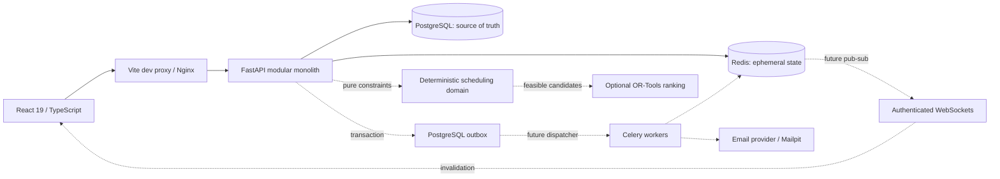

# SlotWise architecture

## Status and scope

Phases 1–4 implement infrastructure, identity, sessions, workspaces, invitations,
membership permissions, account UI, durable account mail, business configuration,
staff qualifications/availability, resources/pools and service requirements. Appointments,
optimization, general notifications and analytics remain designs for later phases.

Phase 1 acceptance is verified on Ubuntu WSL2 with real Docker images, PostgreSQL,
Redis and Nginx. See `PROGRESS.md` for exact tests and remaining nonblocking issues.

## System design

Solid edges are foundation dependencies. Dashed edges are planned. No deployment
requires a distributed transaction or a new microservice.

## Boundaries

`api/v1` owns HTTP adapters and typed transport contracts. Domain modules own
business invariants and use explicit transaction boundaries. `db` owns persistence
configuration and shared metadata conventions. `core` owns settings and logging.
Future domain directories are introduced with working behavior, not empty scaffolds.
The pure scheduling engine will consume immutable snapshots and know nothing about
FastAPI, SQLAlchemy, React, or HTTP.

Application lifespan owns the async SQLAlchemy pool and Redis client and releases
both at shutdown. Liveness is independent of dependencies. Readiness executes real,
bounded PostgreSQL and Redis checks in parallel. Expected connection failures yield
503 with booleans, without exposing exception strings or connection credentials.
Unexpected programming errors remain visible as errors instead of false success.

React uses TanStack Query for server state, Zod for response validation, and local
React state for the responsive menu. Zustand is deferred until shared client state
justifies it. The shadcn-style Button is owned source built on Radix Slot, CVA, and
Tailwind; `components.json` configures future component additions. The shell marks
future modules as unavailable and does not synthesize business metrics.

## Decisions

| Decision | Reason / consequence |
| --- | --- |
| Modular monolith | Keeps multi-resource transactions within one database; domain separation permits later extraction if measured need emerges. |
| PostgreSQL 17 | Range types, GiST exclusions, row locking, transactional outbox. SQLite cannot verify these guarantees. |
| Python 3.13, supported range 3.12–3.13 | Satisfies 3.12+ while keeping native package compatibility bounded. CI and Docker use 3.13. |
| React 19, strict TypeScript, Vite 6 | Conservative compatible toolchain, locked exact dependency resolution; upgrades require validation. |
| pnpm + uv lockfiles | Reproducible installation locally, in CI, and in images. |
| Same-origin frontend proxy | Avoids unnecessary cross-origin cookies; CORS allows only explicit origins and implemented methods. |
| Opaque database-backed tokens | Every authenticated request checks revocation and expiration; access and refresh tokens are never stored in browser storage. |
| UTC instants + IANA rules | Business scheduling uses location-local rules; ambiguous and nonexistent local times require explicit treatment. |
| Unitized resource capacity | Capacity C becomes C reservable units; one exclusion mechanism protects exclusive and capacity reservations. |
| No premium calendar dependency yet | Phase 6 uses FullCalendar standard views; a custom React timeline avoids assuming a commercial redistribution license. |
| Deferred domain dependencies | Celery, OR-Tools, FullCalendar, tables, forms, charts, and date helpers arrive with the phases that exercise them. |

## Implemented identity and tenant boundary

Authenticated user + selected workspace + verified membership produces a tenant
context. An untrusted workspace header alone never grants access. Every tenant query
and mutation scopes by this context; composite foreign keys add database protection.
Roles are checked at service boundaries as well as routes. Platform administration
requires separate explicit authority and audited access; it is not an implicit
cross-tenant bypass. Employee/customer records require ownership filtering.

Phase 2 uses Argon2id, short-lived access tokens, hashed rotating refresh tokens with
reuse-family revocation, HttpOnly cookies, Secure in deployment, SameSite, CSRF token
plus exact Origin validation on writes, Redis rate limiting, invitation and
verification token expiry. Email bearer links use fragments, stripped from browser
history on arrival; fragments never reach HTTP/proxy logs. No tokens in localStorage
or sessionStorage. WebSockets later
validate session and Origin before workspace subscription. Reconnect performs an
authoritative query; events invalidate cached data rather than assert reservations.

Current app logs contain lifecycle and sanitized mail-retry messages. Access logs are disabled in the
container to avoid accidental query-string disclosure. Request IDs, sanitized audit
events beyond the implemented identity/membership audit records, retention automation,
and telemetry belong to later security work. Public
health endpoints contain no customer or tenant data. Documentation is disabled when
`SLOTWISE_ENVIRONMENT=production`; development Compose is not a production template.

## Deployment posture

Compose supplies PostgreSQL, Redis, Mailpit, a one-shot migration service, backend,
and a compiled frontend served by an unprivileged Nginx image. Ports bind to loopback.
Health dependencies gate startup. Migration and API identities should be split in
production, with TLS, secrets management, backups, restore drills, monitoring, and
resource limits. The local database user intentionally has extension-creation rights.

The opt-in Compose `test` profile uses a separate Docker build target, with development
dependencies and integration tests. Identity tests create a random PostgreSQL schema
per test, exercise real commits/locks, and drop only that schema. The default final image derives from
the runtime target and excludes those files. Tests use Compose service DNS instead
of depending on Windows-to-WSL database port forwarding.

Nginx retains a same-origin CSP for the application. Only the exact development
`/api/docs` route permits jsDelivr and Swagger's inline initializer/styles. That route
is disabled by FastAPI in production. Swagger rendering requires CDN connectivity.

## Phase 2 transaction and session decisions

- Access lifetime: 15 minutes; session absolute lifetime: 30 days. Refresh does not
  extend the absolute deadline. Each rotation replaces the access hash and consumes
  the old refresh token. Reuse revokes the entire session family, including the latest
  access token. Password reset revokes every session for that user.
- Session writers lock user then session/token. Concurrent refresh has one success
  and one replay rejection; replay conservatively revokes the family. Browser Web
  Locks plus a per-tab shared promise prevent ordinary concurrent refresh on supported
  browsers. Without Web Locks, multi-tab races may require signing in again.
- CSRF: a random cookie plus matching custom header and exact configured Origin are
  required for unauthenticated writes. Authenticated writes additionally bind the CSRF
  digest to the session. Production uses Secure, host-only `__Host-` cookies; access
  and refresh are HttpOnly; all use SameSite=Strict. API responses are no-store.
- Authorization uses current database membership, never a role embedded in a token.
  Tenant endpoints include workspace scope in child queries. Workspace-row locking
  serializes membership/invitation writes and protects the last-owner invariant.
  Owners manage membership; managers may read team membership; employees/customers
  can read only their workspace profile. Public registration cannot grant platform
  authority. Platform administration is a separate future operational module and has
  no implicit tenant bypass in Phase 2.
- Auth writes use an atomic Redis fixed-window limiter: 20 requests per minute per
  client address and route. Forwarded client-IP headers are deliberately untrusted;
  behind the current Nginx configuration this is a conservative shared proxy limit.
  Redis failure closes auth writes with 503. Tune trusted-proxy identity and limits
  before public deployment; never trust arbitrary forwarded headers.

## Durable account email

Registration, verification/reset requests and invitations insert encrypted mail in
the same PostgreSQL transaction as token creation. The API lifespan polls due mail
when enabled, claims one row with SKIP LOCKED, and uses a bounded SMTP operation in
a thread. Retries back off (up to eight attempts); only exception class is retained.
Recipient/body/token payloads are Fernet-encrypted using a secret-derived key and
erased after successful delivery. Stable Message-ID aids diagnosis; SMTP delivery is
at-least-once across ambiguous send/commit crashes, not exactly-once. One-use tokens
remain authoritative even if an email is delivered twice. Celery reminders and the
general booking outbox remain Phase 8 work.

Production startup requires explicit >=32-character mail secret and HTTPS public/
trusted origins. Configure authenticated STARTTLS SMTP through environment settings.
Keep the encryption secret stable while pending mail exists. Failed mail after eight
attempts requires operator attention; users can request a fresh verification/reset
or an owner can issue a fresh invitation. Runtime logs contain no token or email body.

References: [Argon2 PasswordHasher](https://argon2-cffi.readthedocs.io/en/stable/api.html),
[OWASP CSRF guidance](https://cheatsheetseries.owasp.org/cheatsheets/Cross-Site_Request_Forgery_Prevention_Cheat_Sheet.html).

Sources: [FastAPI lifespan](https://fastapi.tiangolo.com/advanced/events/),
[Vite runtime requirements](https://vite.dev/guide/),
[PostgreSQL range constraints](https://www.postgresql.org/docs/17/rangetypes.html).

## Phase 3 business configuration

Location pages batch their schedule reads: one query each for weekly rules, dated
exceptions and exception windows, scoped by workspace and the page's location IDs.
In-memory grouping by location/date preserves schedule ownership and ordering.
This bounds query count independently of page size without changing API contracts
or the database schema. A PostgreSQL regression compares single-location and
multi-location query counts and verifies distinct schedules for shared dates.

The `business` module owns profile/policy settings, locations, weekly rules and dated
exceptions. Owners write; managers read; employee/customer accounts do not access
internal business settings. Every lookup scopes to the verified workspace. Composite
foreign keys protect location-owned rules even if an application query is wrong.
All configuration writes take the existing workspace row guard, recheck membership,
compare the supplied version and commit the aggregate plus audit record atomically.
Stale versions return 409. Multi-query schedule reads use the same guard to avoid
combining old exception rows with new windows. This favors correctness over throughput.

Workspace name and default zone retain their existing canonical columns. Other profile
fields and a validated policy document live in `business_profiles`; locations retain
their own explicit IANA zones. Changing the business default never rewrites locations.
Locations can be deactivated/reactivated rather than deleted, preserving future
history references. Weekly intervals and exception windows are normalized rows;
replacement occurs atomically under the guard. Policies are a small typed JSONB value
object with numeric bounds, not unstructured client metadata.

The pure civil-time utility has no database/HTTP imports. Intervals use local minutes
from midnight, half-open [start,end), with 1440 allowed only as an end. Overnight
hours must be split across days. Holidays close a date; special hours replace its
weekly rules. Each location/date has at most one exception. No annual holiday calendar
or automatic national-holiday import is implied.

UTC round trips reject nonexistent boundaries. Dated special hours with such a
boundary fail validation. A recurring rule encountering a DST gap produces a preview
warning and no hours for that date, until the owner supplies valid special hours.
Repeated autumn boundaries choose the earliest start and latest end, keeping the
business continuously open across both folds; expanded overlaps are unioned.
Opening-hour preview is not appointment availability. Policy enforcement for actual
bookings and edits affecting existing reservations arrives with Phase 5.

## Phase 4 — scheduling configuration

The `catalog` domain owns staff, skills, physical resources, resource pools and services.
Owners and managers can read and edit configuration; employee and customer memberships
cannot access these internal endpoints. Profile titles describe scheduling duties, not
account authorization. Workspace membership remains managed by the Team module.

A closed, discriminated catalog model shares identity, name, active state, location
and optimistic version across five kinds. This avoids duplicating CRUD and concurrency
code while retaining distinct Pydantic contracts and pure scheduling functions.
Catalog links, service locations, requirements and stable capacity units are relational,
with composite tenant-and-kind foreign keys. Foreign references never live in JSON.
Bounded scalar details and availability rules are validated JSONB value objects, edited
atomically with their parent. This intentionally refines the earlier separate-table
proposal: schedule rows currently have no independent lifecycle, permissions or query
requirements. Extract them into relations if future analytics needs indexed rule queries.

All writes take the workspace guard, validate references and dependent configuration,
check the expected version, replace child selections, update capacity units and append
an audit event in one transaction. Reads batch child tables rather than querying per
item. Capacity reductions deactivate surplus units without deleting or renumbering them.
Reactivation reuses the same unit IDs. Phase 5 must reject reductions affecting bookings.
Catalog items are deactivated, not deleted. Location/type changes of referenced items
are rejected until dependent service/pool selections are removed.

The UI has Staff, Skills, Resources, Resource pools and Services sections, search,
validated forms, explicit reload/discard actions and persisted configuration previews.
The catalog screen loads on demand to keep its forms out of the initial bundle.
Lists use paginated APIs; selection screens currently collect all pages for a workspace.
Large-workspace remote-search selectors are a future scalability improvement.

Verification also aligned earlier ORM unique-constraint names with their immutable
Phase 2/3 migrations; no existing database constraint or migration was changed.

## Phase 5 availability milestone

The scheduling package separates a pure snapshot-based search engine from the HTTP
and SQLAlchemy adapter. The adapter reads tenant-scoped configuration and stable active
units under the workspace guard, then commits the read transaction before calculating.
Bounded backtracking allocates resources jointly; reusable calendar/eligibility functions
enforce existing catalog semantics. The internal owner/manager API reports explicitly
that appointment persistence is absent. Booking writes must revalidate under transaction
locks and database exclusion constraints; an availability response cannot authorize a
reservation. No UI or database schema change belongs to this first milestone.

The second Phase 5 milestone adds persistent booking transactions and migration 0005.
Availability now includes committed allocations. Booking creation/rescheduling use
the same engine with an exact start, retain the workspace lock through commit, and
acquire unit locks in stable order. PostgreSQL exclusion enforces buffered capacity
independently. Versioned history, audit and idempotency receipts share the transaction.
Booking events form durable outbox input; delivery is intentionally deferred. Internal
owner/manager routes enforce cancellation policies; public ownership and UI are pending.
Configuration updates conservatively reject upcoming allocations until explicit conflict
resolution exists. See the API/engine docs for limits and retry behavior.

The final Phase 5 milestone adds a lazy-loaded Appointments management section. Zod
validates API receipts and slots; TanStack Query keys include workspace/search/page.
Search-field changes clear selections. The command hook freezes uncertain writes and
reuses their key on explicit retry; it does not persist commands after navigation.
Times use the selected location's IANA zone with numeric offsets to distinguish DST
folds. Rescheduling previews may exclude their own tenant-scoped active appointment,
while transactional revalidation remains unchanged. Desktop/mobile browser tests use
real PostgreSQL, Redis and Mailpit and cover the full booking lifecycle.

Phase 6 introduces a separate lazy-loaded Calendar section. It shares
booking configuration queries and uses workspace/range/filter-scoped cache keys. The
API filters service-time overlap and snapshot assignments; the browser groups results
by IANA-zone civil dates. Civil arithmetic uses UTC noon to avoid browser-zone DST
normalization. A padded UTC query envelope includes all possible offsets; exact local
grouping removes the padding from display. Large result sets stop with an explicit
error at 5,000 records. Pagination itself is not snapshot-consistent; the realtime
invalidation feed refreshes it after concurrent booking changes. Manual refresh remains
available.

Daily staff/resource timelines reuse the filtered booking snapshots. Pure layout code
groups assignments, clips reservation spans to actual local-day UTC bounds and partitions
overlaps into deterministic lanes. Rows show appointment concurrency, not one row per
capacity unit; each resource card labels its unit demand. Cancelled history excludes
buffer shading because it no longer reserves capacity. A larger query envelope captures
buffer-only spans at extreme offsets. Sticky labels, a scrollable axis and an alternative
appointment list preserve access on mobile and for short-duration cards.

Timeline pointer gestures now produce move/resize proposals measured in elapsed UTC
minutes; moves snap to 15 minutes and duration changes snap to the service's duration
step. Keyboard arrows and details-dialog buttons provide alternatives to dragging.
Gestures retain the staff assignment; dragging between rows does not reassign staff or
resources. A modal compares original/proposed times with offsets before issuing the
existing versioned, idempotent reschedule command. The backend revalidates duration,
availability and resource allocation transactionally. The persisted card remains at its
original position until success, so a rejected proposal does not leave an optimistic
placement behind. Success and rejection invalidate calendar, booking and availability
queries. Uncertain responses lock modal dismissal and reuse the exact command/key;
as with the booking editor, requests are not persisted across page reloads.

Migration 0006 adds a bigint workspace calendar revision. Booking mutations increment
it under the existing workspace lock in the same transaction as allocations, history
and receipts. Rollbacks and idempotency replays do not increment it. Realtime readers
perform a short authenticated database read every two seconds and send SSE invalidation
signals when the revision changes. Connections hold no database session while waiting;
this works across API processes and restarts without an in-memory broadcaster. Events
contain only revision strings, never appointment or customer payloads.

Each connection emits `ready`, causing a full scoped query refresh, so reconnects do
not depend on retained event cursors. Streams recheck session, verified identity,
workspace suspension and owner/manager membership before every heartbeat/change. They
rotate after about 50 seconds; access expiry uses the normal API refresh path and
revocation clears cached booking data and stops the connection. The client pauses on
hidden/offline pages, ignores late callbacks after disposal, retries with exponential
backoff capped at 30 seconds, and reconnects if no event arrives for 15 seconds. Nginx
honors `X-Accel-Buffering: no`; heartbeat events keep the stream active.

This delivers booking updates with approximately two-second detection latency, not
instant per-write fanout. Database reads scale with visible calendar clients; measure
that cost in Phase 11 before replacing the bounded polling with a shared notifier.
Configuration changes do not publish booking revisions; reopen or refresh setup data
after editing configuration. Notification dispatch remains separate Phase 8 work.
