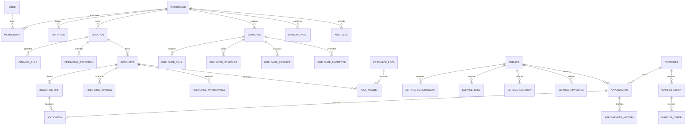
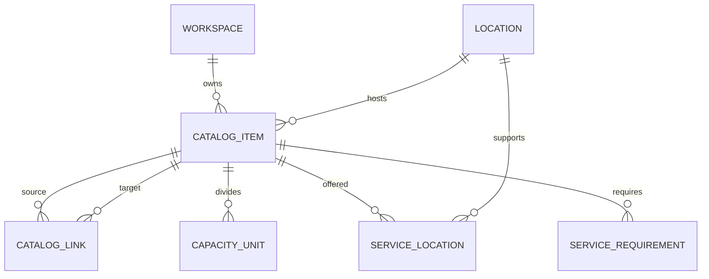

# Database design

This is the target normalized design. Phase 1 migrates `btree_gist`; Phase 2 revision
`0002` adds users, sessions, refresh_tokens, action_tokens, workspaces, memberships,
invitations, audit_logs and auth_mail. Phase 3 revision `0003` adds business_profiles,
locations, opening_rules, operating_exceptions and exception_windows. Phase 4 revision
`0004` adds catalog_items, catalog_links, service_locations, service_requirements and
capacity_units. Booking tables remain planned. See the concrete Phase 4 mapping below.

Identity records use UUID keys and UTC timestamptz. Email and workspace slug are
unique. Membership uses composite `(workspace_id,user_id)` primary key. Invitations
carry workspace ownership and unique token digests; all invitation mutations scope
to that workspace. Role CHECK constraints reject unknown/platform roles. Session,
refresh and action token values are SHA-256 digests of 256-bit random secrets, never
plaintext. Mail contains encrypted link payloads only until delivered. Audit rows
contain action, actor and object identifiers, with no passwords or token payloads.

The fixed `0002` migration is independent of mutable ORM metadata. Integration tests
use matching ORM metadata only within isolated UUID-named test schemas. Foundation
tests separately assert the migration actually applied to the Compose database.

Phase 3 migrations are also immutable. Business profiles use workspace_id as their
primary key, version, contact fields and a validated JSONB policy value object.
Locations expose UNIQUE(workspace_id,id), a version and active flag. Weekly rules
use (workspace_id,location_id,weekday,start) as the primary key; weekday and interval
CHECK constraints reject invalid bounds. Exceptions use (workspace_id,location_id,day)
as the primary key and a holiday/special kind CHECK. Exception windows reference that
entire key and carry interval CHECK constraints. All child foreign keys include the
workspace. Non-overlap and holiday/window consistency are service invariants under
the workspace guard, not standalone database exclusions. Profile defaults are returned
for existing workspaces without silently inserting rows on GET; first save uses version 0.

## Entity relationships



All tenant entities carry non-null `workspace_id`, including join tables. The diagram
omits repeated workspace edges for readability. Users, sessions, and platform audit
records are global. Membership has a unique `(workspace_id,user_id)` pair. Customers
may link to a user but contact information is workspace-local. Employees may link to
a membership and have one staff resource with unitized capacity; allocations thus
use the same representation for staff and physical assets.

## Table contracts

| Group | Required data / constraints |
| --- | --- |
| users, sessions, verification_tokens | UUID, normalized unique email, Argon2 hash; hashed opaque token, family, expiry, consumed/revoked timestamps; one-use token transitions |
| workspaces, memberships, invitations | Workspace slug unique; role enum; invite token hash, normalized email, expiry, accepted timestamp; suspended state |
| locations | Workspace, name, IANA timezone, active; no fixed UTC offset |
| opening_rules, operating_exceptions | Weekday/local start and end; dated closure or replacement intervals; split overnight rules at midnight |
| employees, skills, employee_skills | Membership link, display profile, active, skill validity; unique employee/skill pair |
| employee_schedules, absences, exceptions | Location-local recurring intervals and explicit UTC exclusions/overrides; approval status |
| resources, resource_units | Location, type, capacity, active, JSONB descriptive attributes; numbered stable units; unique resource/unit number |
| resource_windows, maintenance | Availability rules and unavailable UTC intervals; do not delete historical maintenance |
| pools, pool_members | Pool location/type; unique pool/resource pair |
| services, service_locations, service_skills, service_employees | Duration bounds/increment; money in minor units plus ISO currency; buffers nonnegative; explicit eligibility |
| service_requirements | Specific resource OR pool OR type selector, positive quantity, per-resource capacity demand, location compatibility; check exactly one selector |
| customers | Workspace-local contact details, consent/retention metadata; no medical records |
| appointments | Customer, service, location, UTC start/end, local timezone snapshot, status, version, price/duration/buffer snapshot; start < end |
| allocations | Workspace, appointment, resource unit, occupied `tstzrange`, blocking boolean; nonempty finite half-open interval |
| appointment_history | Appointment, actor, transition, timestamp, reason; immutable history |
| idempotency_requests | Unique workspace/principal/key, canonical payload digest, appointment/result reference, expiry; different payload returns conflict |
| waitlist_entries, offers | Service/date/time preferences; ordered created_at; offer token hash, expiry and atomic pending/accepted/expired transitions |
| outbox_events, notification_deliveries | Event UUID, aggregate version, payload schema, attempts, next_attempt, lease expiry; unique event/channel/recipient delivery key |
| audit_logs | Workspace, actor, action, object identifiers, sanitized metadata; retention-controlled and access-audited |

## Integrity and indexes

Use UUID primary keys and UTC `timestamptz` timestamps. Tenant tables also expose
`UNIQUE(workspace_id,id)` so child references use `(workspace_id,parent_id)` composite
foreign keys. Index foreign keys and primary list filters, typically
`(workspace_id,location_id,start_at,id)`, employee eligibility, pool membership,
and pending outbox `(next_attempt_at,id)` with a status predicate. Use GiST indexes
for occupied ranges and keyset pagination for growing lists.

Planned allocation guard:

```sql
CREATE EXTENSION IF NOT EXISTS btree_gist;
ALTER TABLE allocations ADD CONSTRAINT no_overlapping_unit
EXCLUDE USING gist (
  workspace_id WITH =,
  resource_unit_id WITH =,
  occupied WITH &&
) WHERE (blocking);
```

`occupied = [start-preparation, end+cleanup)` so adjacency is permitted but buffers
are protected. Each occupied unit gets a row. Quantity/capacity reductions must
reject changes that invalidate future reservations; never renumber units in place.
The constraint predicate must use the allocation's own blocking field; it cannot
join appointment status. All lifecycle mutations update status, allocations, history,
outbox, and version in one transaction. Completed/no-show reservations remain historical
blocking allocations; cancellation releases them. Exclusion constraints are a last
line of defense; opening hours and qualifications still require locked revalidation.

Prefer inactive flags for catalog records referenced by history. Contact deletion
uses a documented anonymization/retention process, not cascade deletion of booking
history. No broad soft-delete framework. Customer data must not enter outbox payloads
unnecessarily. Retention duration and lawful basis require business/legal decisions.

## Phase 4 implemented storage (revision 0004)

The earlier ER diagram is a domain target. The concrete Phase 4 representation is:



- `catalog_items`: UUID, workspace, kind, name, active, version, optional location,
  validated details JSONB. Kind is restricted to skills/staff/resources/pools/services;
  staff/resources/pools require a tenant-scoped location. The kind is immutable.
- `catalog_links`: tenant-scoped source/target references including kind. Permitted
  edges are staff-to-skill, pool-to-resource, and service-to-skill/staff/resource.
  Staff qualification links optionally expire at the end of an inclusive local date.
- `service_locations`: a relational service/location selection, with composite FKs.
- `service_requirements`: ordered rows with exactly one resource, pool or type selector,
  asset quantity and units per asset. Quantities/units are bounded positive integers;
  a specific asset has quantity one. Null selector combinations are explicitly rejected.
- `capacity_units`: stable UUIDs for staff or resource capacity, numbered 1–100,
  unique per item/number. Surplus units are retained inactive after a capacity reduction.

Scalar details include duration bounds/increments, minor-unit price and supported currency,
service buffers/notice override, resource attributes, staff job title and availability.
Availability JSONB stores bounded weekly intervals/breaks, dated replacements and UTC
unavailable periods. Relationships are normalized, never duplicated in the details JSON.
API views reconstruct typed objects from batched joins. See the architecture decision
for this deliberate refinement of the original separate-table design.

No destructive catalog delete exists. Audit records hold identifiers and actions only.
Migration 0004 is a fixed SQL snapshot independent of mutable ORM metadata. The future
allocation table should reference `(workspace_id, capacity_unit_id)` for both staff
and assets; no allocation/exclusion or reservation behavior is claimed in Phase 4.
